<div align="center">

# 🛡️ FraudLens

### Financial Risk Intelligence & Fraud Analytics

**Detect anomalies. Understand risk. Drive intelligent decisions.**

An end-to-end financial analytics and machine learning platform that transforms complex transaction data into actionable fraud intelligence.


[Overview](#-overview) •
[Features](#-key-features) •
[Architecture](#-system-architecture) •
[Results](#-model-performance) •
[Installation](#-getting-started)

</div>

---

## 📌 Overview

Financial fraud detection is not simply a classification problem — it is a challenge of identifying rare, high-risk events while minimizing disruption to legitimate transactions.

**FraudLens** is a full-stack financial risk intelligence platform designed to address this challenge through data analytics, machine learning, interactive visualizations and configurable fraud detection mechanisms.

Unlike conventional fraud detection notebooks, FraudLens integrates the entire analytical pipeline into an interactive web application, enabling users to explore transaction patterns, compare predictive models, screen transactions and evaluate the financial implications of classification decisions.

---

## 📊 FraudLens at a Glance

<div align="center">

| Transactions Analysed | ML Models | Dashboard Modules | Best Model Accuracy |
| :---: | :---: | :---: | :---: |
| **283,726** | **3** | **6** | **99.95%** |

| Precision | Recall | F1-Score | Optimal Threshold |
| :---: | :---: | :---: | :---: |
| **90.00%** | **76.06%** | **82.44%** | **0.49** |

*Random Forest results on the held-out test dataset.*

</div>

---

## 🖥️ Dashboard Preview

FraudLens provides a unified analytical workspace with six interconnected modules.

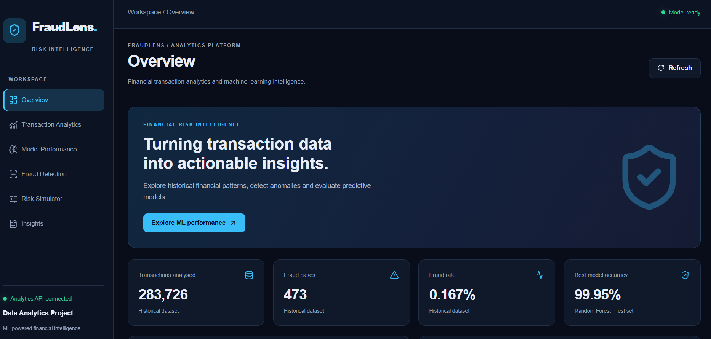

---

## ✨ Key Features

| Feature | Description |
|---|---|
| Financial Intelligence Dashboard | Monitor transaction statistics, fraud rates and financial exposure |
| Exploratory Data Analysis | Explore distributions, correlations, outliers and temporal patterns |
| Multi-Model Comparison | Evaluate Logistic Regression, Random Forest and XGBoost |
| Transaction Screening | Perform individual fraud predictions using trained ML models |
| Batch Fraud Detection | Upload CSV files and analyse up to 10,000 transactions |
| Risk Simulator | Explore the impact of decision thresholds on classification performance |
| Financial Impact Analysis | Quantify detected fraud, missed fraud and false alarm exposure |
| Feature Importance | Identify influential features in Random Forest predictions |
| Downloadable Reports | Export batch prediction results as CSV |
| REST API | Access analytics and model inference through FastAPI |

---

## 🏗️ System Architecture

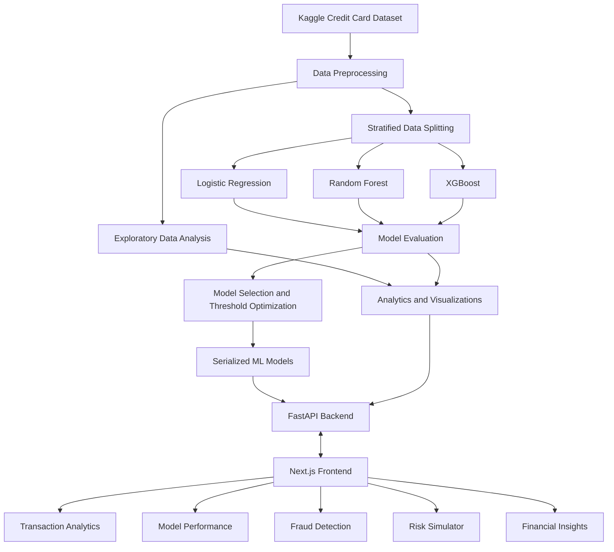

### Application Workflow

```text
Raw Transaction Data
        ↓
Data Cleaning and Preprocessing
        ↓
Exploratory and Statistical Analysis
        ↓
Machine Learning Model Training
        ↓
Performance Evaluation
        ↓
Decision Threshold Optimization
        ↓
Model and Analytics Export
        ↓
FastAPI REST Services
        ↓
Interactive Next.js Dashboard
```

---

## 📂 Dataset

The project uses the publicly available Credit Card Fraud Detection dataset from Kaggle.

**Dataset:** [Credit Card Fraud Detection](https://www.kaggle.com/datasets/mlg-ulb/creditcardfraud)

| Attribute | Description |
|---|---|
| Original records | 284,807 |
| Duplicate records removed | 1,081 |
| Cleaned records | 283,726 |
| Legitimate transactions | 283,253 |
| Fraudulent transactions | 473 |
| Fraud rate | Approximately 0.167% |
| Input features | 30 |
| Target variable | Class |
| Classification type | Binary classification |

### Feature Description

- `Time` — Seconds elapsed since the first recorded transaction.
- `V1–V28` — Anonymized PCA-transformed numerical features.
- `Amount` — Transaction amount.
- `Class` — Target variable: 0 for legitimate and 1 for fraudulent.

### Class Imbalance

Fraudulent transactions account for less than 0.2% of the dataset, making conventional accuracy an insufficient measure of model effectiveness.

FraudLens therefore emphasizes precision, recall, F1-score, Average Precision and financial impact alongside accuracy.

---

## 🔬 Analytical Methodology

### 1. Data Preprocessing

- Duplicate record identification and removal
- Missing value analysis
- Statistical examination of numerical features
- Feature and target separation
- Feature scaling for Logistic Regression
- Stratified dataset splitting

### 2. Dataset Partitioning

| Dataset | Proportion | Records |
|---|---:|---:|
| Training | 70% | 198,608 |
| Validation | 15% | 42,559 |
| Testing | 15% | 42,559 |

The validation dataset was used for model selection and threshold optimization, while the test dataset was reserved for final performance evaluation.

### 3. Exploratory Data Analysis

The analytical pipeline investigates transaction behaviour through:

- Class distribution analysis
- Transaction amount distribution
- Descriptive statistics
- Outlier analysis
- Feature correlation analysis
- Temporal fraud patterns
- Fraud versus legitimate transaction comparisons

---

## 📈 Exploratory Data Analysis

<table>
<tr>
<td width="50%" align="center">
<b>Class Distribution</b><br>
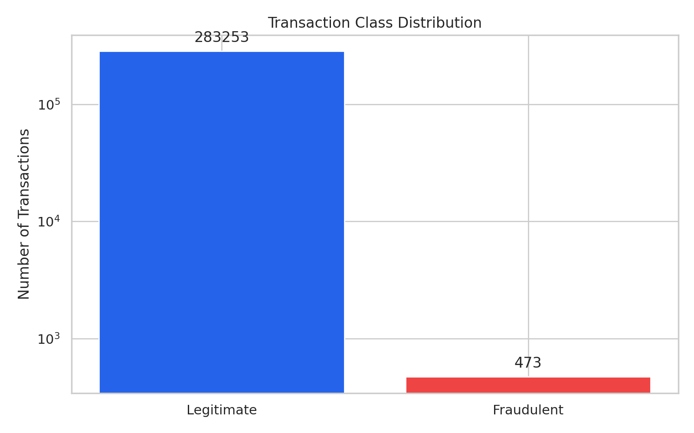
</td>
<td width="50%" align="center">
<b>Transaction Amount Distribution</b><br>
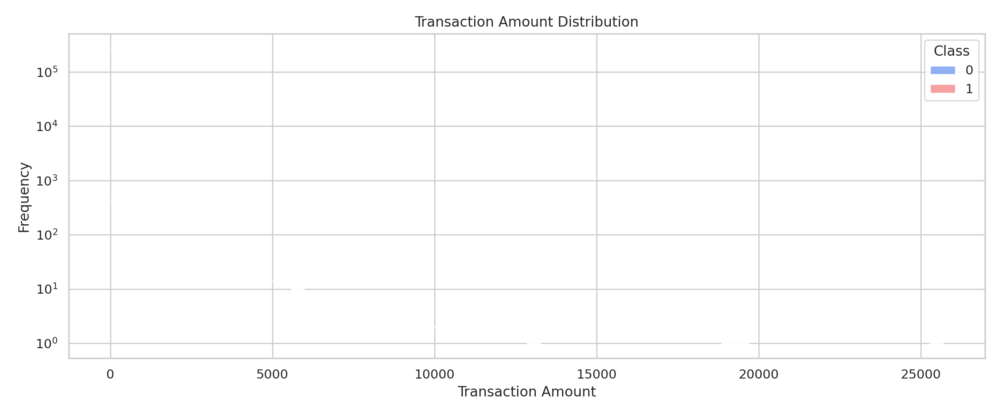
</td>
</tr>
<tr>
<td align="center">
<b>Correlation Heatmap</b><br>
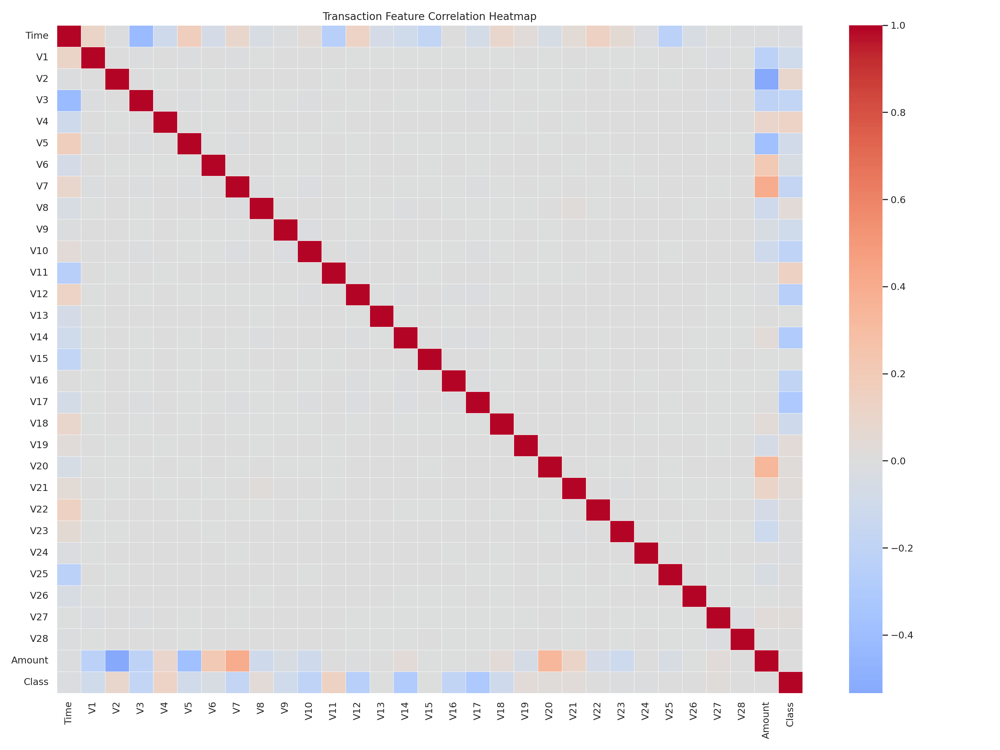
</td>
<td align="center">
<b>Outlier Analysis</b><br>
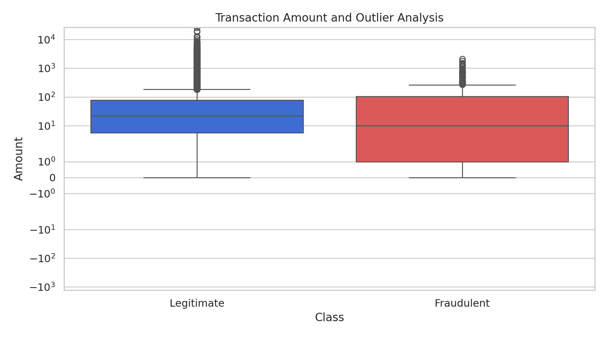
</td>
</tr>
<tr>
<td align="center">
<b>Temporal Fraud Analysis</b><br>
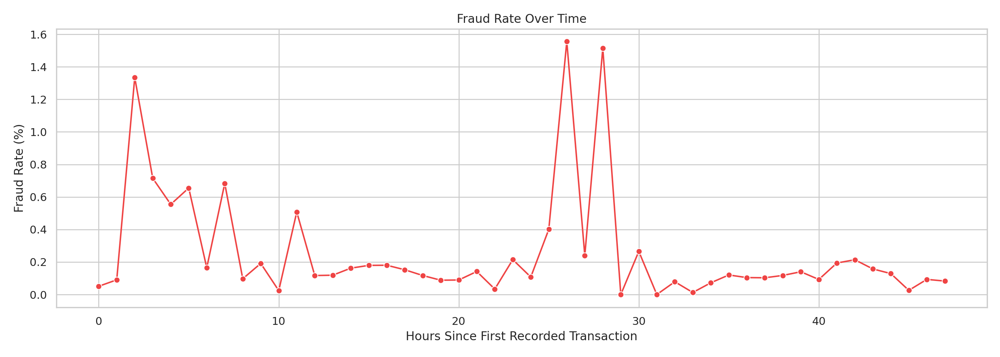
</td>
<td align="center">
<b>Transaction Pattern Analysis</b><br>
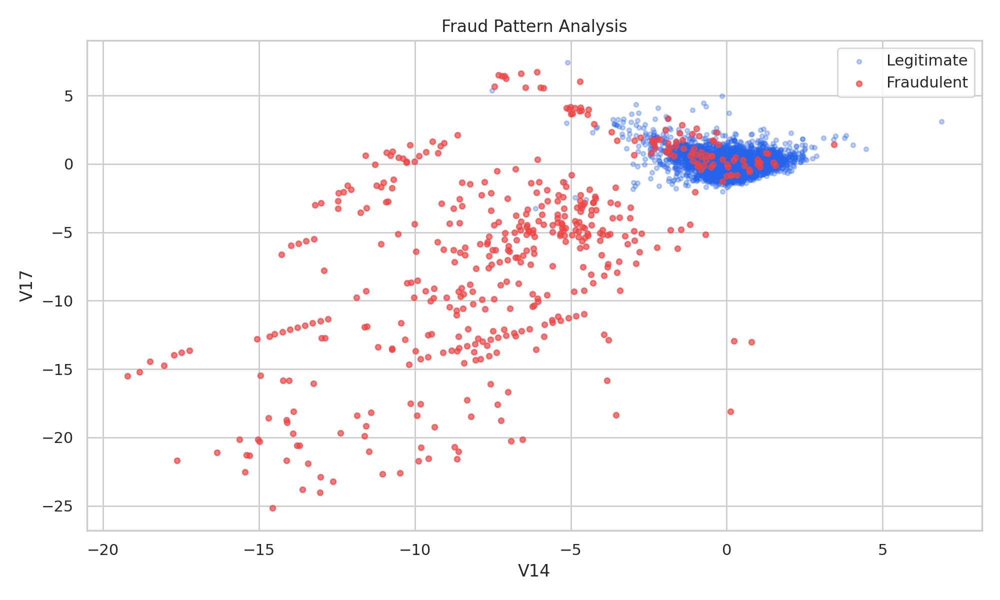
</td>
</tr>
</table>

---

## 🤖 Machine Learning Models

FraudLens implements three supervised machine learning algorithms with imbalance-aware training configurations.

| Algorithm | Approach |
|---|---|
| Logistic Regression | Linear classification with feature scaling and class weighting |
| Random Forest | Ensemble learning using multiple decision trees and balanced class weights |
| XGBoost | Gradient-boosted decision trees with imbalance-aware weighting |

---

## 🎯 Model Performance

### Classification Metrics

Results obtained on the held-out test dataset at a decision threshold of 0.50.

| Model | Accuracy | Precision | Recall | F1-Score | ROC AUC |
|---|---:|---:|---:|---:|---:|
| Logistic Regression | 97.43% | 5.48% | **88.73%** | 10.32% | **96.08%** |
| **Random Forest** | **99.95%** | **90.00%** | 76.06% | **82.44%** | 93.35% |
| XGBoost | 99.90% | 66.28% | 80.28% | 72.61% | 95.81% |

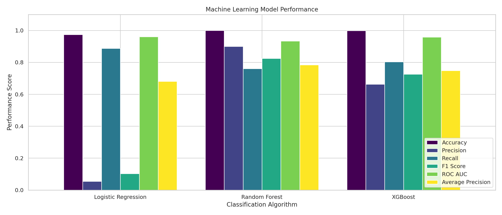

### Why Random Forest?

Random Forest was selected based on validation Average Precision.

Its strong precision and F1-score demonstrate an effective balance between identifying fraudulent transactions and minimizing unnecessary fraud alerts.

Although Logistic Regression achieves higher recall, its substantially larger number of false positives makes it less suitable for scenarios where unnecessary transaction interruptions carry operational costs.

### Confusion Matrix Comparison

| Model | TP | TN | FP | FN |
|---|---:|---:|---:|---:|
| Logistic Regression | 63 | 41,401 | 1,087 | 8 |
| Random Forest | 54 | 42,482 | 6 | 17 |
| XGBoost | 57 | 42,459 | 29 | 14 |

### Random Forest Confusion Matrix

<div align="center">

| Actual / Predicted | Legitimate | Fraudulent |
|---|---:|---:|
| Legitimate | **42,482 (TN)** | 6 (FP) |
| Fraudulent | 17 (FN) | **54 (TP)** |

</div>

### ROC and Precision-Recall Analysis

<table>
<tr>
<td width="50%" align="center">
<b>ROC Curve</b><br>
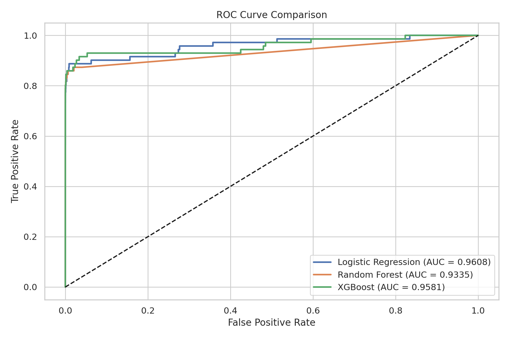
</td>
<td width="50%" align="center">
<b>Precision-Recall Curve</b><br>
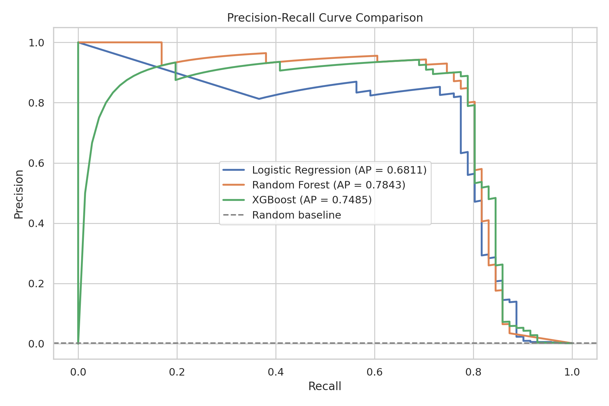
</td>
</tr>
</table>

---

## ⚖️ Decision Threshold Optimization

Traditional binary classification commonly uses a fixed threshold of 0.50.

FraudLens evaluates alternative decision thresholds using validation data to understand the trade-off between fraud detection sensitivity and false alarms.

| Parameter | Value |
|---|---|
| Selected model | Random Forest |
| Default threshold | 0.50 |
| Optimized threshold | 0.49 |
| Optimization objective | Validation F1-score |

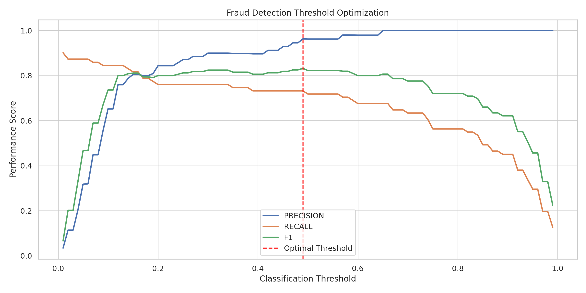

The interactive Risk Simulator allows users to explore how classification thresholds affect precision, recall, F1-score and confusion matrix outcomes.

---

## 💰 Financial Impact Analysis

Fraud detection effectiveness extends beyond classification metrics.

FraudLens evaluates the historical transaction values associated with detected fraud, missed fraud and incorrectly flagged legitimate transactions.

| Model | Detected Fraud Value | Missed Fraud Value | False Alarm Exposure |
|---|---:|---:|---:|
| Logistic Regression | 7,196.96 | 2,043.71 | 352,845.63 |
| **Random Forest** | **5,749.63** | **3,491.04** | **293.16** |
| XGBoost | 6,008.93 | 3,231.74 | 3,705.95 |

*Historical test transaction amounts at threshold 0.50, expressed in dataset amount units.*

### Key Business Insight

Random Forest reduces false alarm exposure substantially compared with Logistic Regression, while maintaining strong overall classification performance.

These results demonstrate why fraud detection systems must consider both detection effectiveness and the operational consequences of false positives.

Historical detected fraud value should not be interpreted as guaranteed financial savings.

---

## 🧠 Model Interpretability

FraudLens includes Random Forest feature importance analysis to identify the numerical features contributing most strongly to the model's decisions.

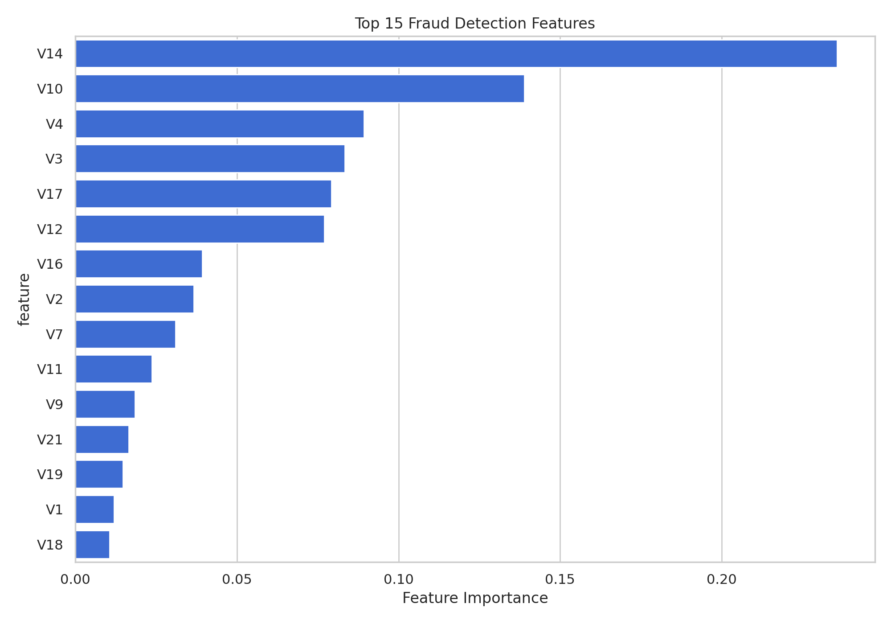

Since V1–V28 are anonymized PCA features, their underlying business meanings cannot be directly inferred.

---

## 🖥️ Dashboard Modules

### 01 — Overview

A centralized workspace presenting dataset statistics, fraud distribution, transaction patterns and recommended model performance.


### 02 — Transaction Analytics

Interactive transaction volume analysis combined with statistical distributions, correlation heatmaps and outlier visualizations.

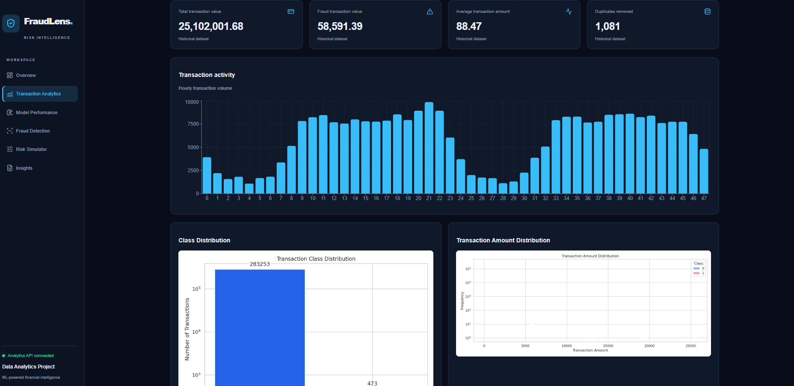

### 03 — Model Performance

A comparative evaluation of all three machine learning algorithms, including classification metrics, confusion matrices and performance curves.

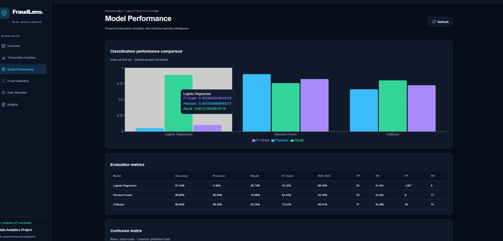

### 04 — Fraud Detection

Individual transaction screening using trained machine learning models, configurable thresholds and actual versus predicted class comparisons.

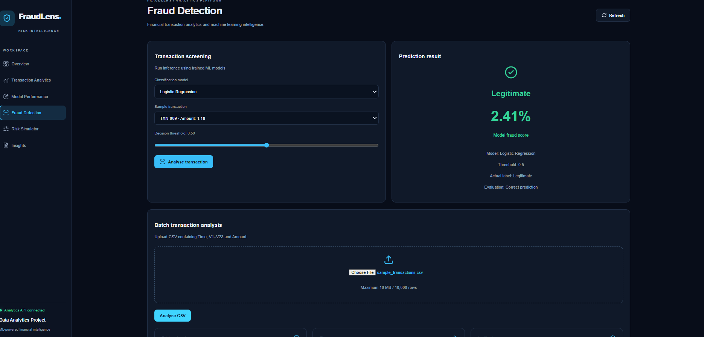

### 05 — Risk Simulator

An interactive decision threshold laboratory for examining the trade-off between detection sensitivity and false positives.

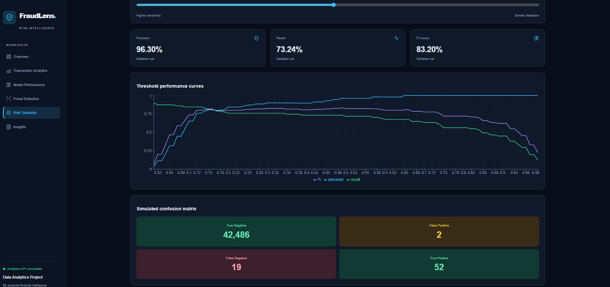

### 06 — Financial Insights

Financial exposure analysis, missed fraud values, false alarm exposure and model feature importance.

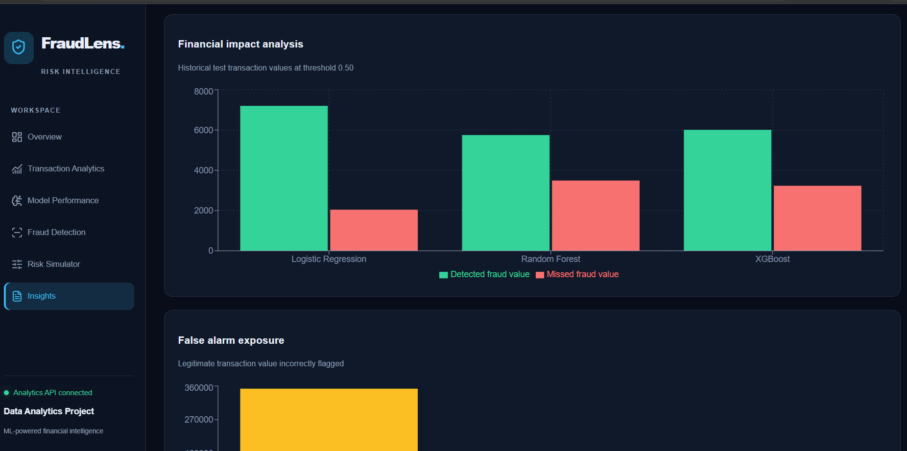

---

## 🛠️ Technology Stack

| Layer | Technologies |
|---|---|
| Frontend | Next.js, TypeScript, Tailwind CSS |
| Visualization | Recharts, Matplotlib, Seaborn |
| UI Components | Lucide React |
| Backend | FastAPI, Uvicorn |
| Machine Learning | Scikit-learn, XGBoost |
| Data Processing | Pandas, NumPy |
| Model Serialization | Joblib |
| Experimentation | Google Colab |
| Version Control | Git, GitHub |

---

## 📁 Repository Structure

```text
FraudLens/
│
├── backend/
│   ├── main.py
│   └── requirements.txt
│
├── frontend/
│   ├── app/
│   │   ├── page.tsx
│   │   ├── layout.tsx
│   │   └── globals.css
│   ├── package.json
│   └── next.config.ts
│
├── models/
│   ├── best_model.joblib
│   ├── logistic_regression.joblib
│   ├── random_forest.joblib
│   └── xgboost.joblib
│
├── notebooks/
│   └── Copy_of_FraudLens_Analytic.ipynb
│
├── results/
│   ├── dashboard_data.json
│   ├── model_comparison.csv
│   ├── financial_impact.csv
│   ├── feature_importance.csv
│   ├── threshold_analysis.csv
│   ├── transaction_statistics.csv
│   └── sample_transactions.csv
│
├── visualizations/
├── screenshots/
├── .gitignore
└── README.md
```

---

## 🚀 Getting Started

### Prerequisites

- Python 3.12
- Node.js
- npm
- Git

### 1. Clone the Repository

Copy the HTTPS clone URL from the repository's Code menu.

```bash
git clone YOUR_REPOSITORY_URL
cd FraudLens
```

### 2. Start the Backend

```powershell
cd backend

py -3.12 -m venv venv

.\venv\Scripts\python.exe -m pip install -r requirements.txt

.\venv\Scripts\python.exe -m uvicorn main:app --port 8000
```

Backend: http://localhost:8000

Swagger Documentation: http://localhost:8000/docs

### 3. Start the Frontend

Open a separate terminal.

```powershell
cd frontend

npm.cmd install

Set-Content .env.local "NEXT_PUBLIC_API_URL=http://127.0.0.1:8000"

npm.cmd run dev
```

Open http://localhost:3000 in your browser.

The repository includes pretrained models and exported analytical results, so model retraining is not required to run the application.

---

## 🔌 API Reference

| Method | Endpoint | Description |
|---|---|---|
| GET | `/` | API health and configuration |
| GET | `/api/analytics` | Complete analytical dataset |
| GET | `/api/overview` | Dataset overview |
| GET | `/api/models` | Model evaluation metrics |
| GET | `/api/thresholds` | Threshold analysis |
| GET | `/api/feature-importance` | Feature importance |
| GET | `/api/financial-impact` | Financial impact metrics |
| GET | `/api/hourly-analysis` | Temporal transaction analytics |
| GET | `/api/samples` | Sample transactions |
| POST | `/api/predict` | Individual fraud prediction |
| POST | `/api/predict-batch` | Batch CSV prediction |

Interactive API documentation is automatically generated using FastAPI Swagger UI.

---

## 🧪 Google Colab Implementation

The complete data preprocessing, exploratory analysis, model training, evaluation and artifact generation workflow is available in the project notebook.

[View the Data Analytics Notebook](notebooks/Copy_of_FraudLens_Analytic.ipynb)

---

## 🔍 Key Findings

- Extreme class imbalance makes accuracy alone unreliable for fraud detection.
- Random Forest achieves the strongest F1-score among the evaluated models.
- Logistic Regression identifies more fraudulent transactions but generates substantially more false positives.
- Decision thresholds influence the balance between fraud detection sensitivity and operational disruption.
- Financial exposure provides an additional perspective beyond traditional classification metrics.

---

## ⚠️ Limitations

- The dataset represents historical transactions rather than a live banking stream.
- PCA-transformed features limit direct business-level interpretability.
- Model scores are not calibrated fraud probabilities.
- Performance may change when applied to newer transaction distributions.
- FraudLens is an academic research prototype, not a production banking system.

---

## 🔮 Future Scope

- SHAP-based explainable AI
- Real-time transaction streaming
- Cost-sensitive threshold optimization
- Model drift detection
- Automated model retraining
- Role-based authentication
- Cloud deployment
- Integration with financial transaction APIs

---

## 👩‍💻 Author

**Misba Khan**

B.Tech — Computer Science and Engineering  
Presidency University, Bengaluru

Interests: Machine Learning, Artificial Intelligence, Data Analytics, FinTech and Full-Stack Development.

---

<div align="center">

### FraudLens

*Turning financial data into intelligent decisions.*

Developed as an end-to-end Data Analytics and Machine Learning project.

⭐ Star this repository if you find the project useful.

</div>
